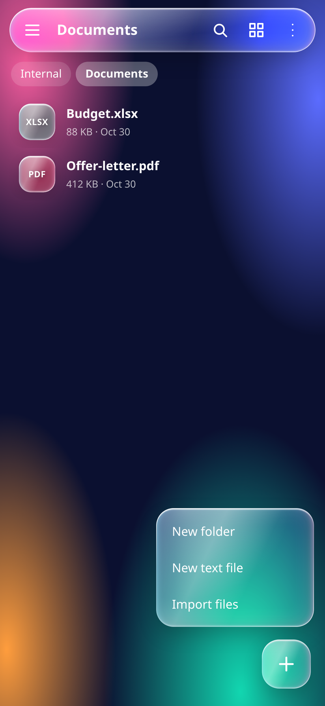
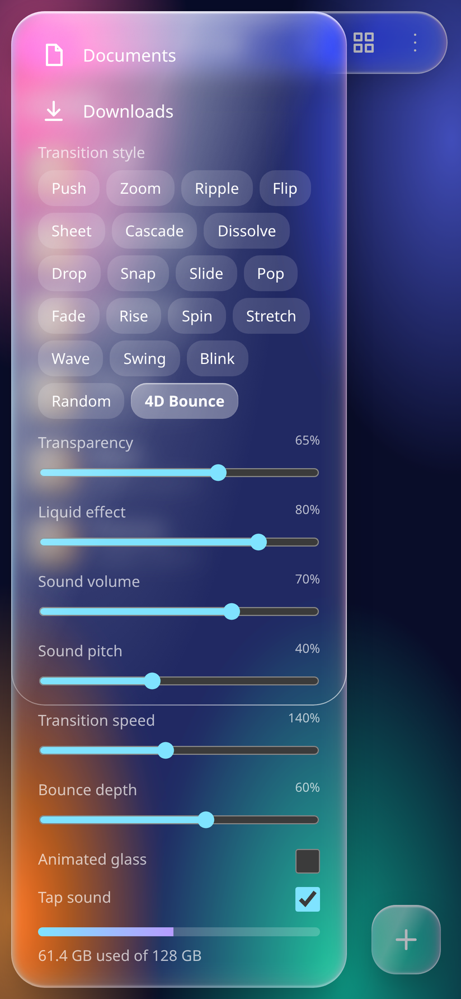
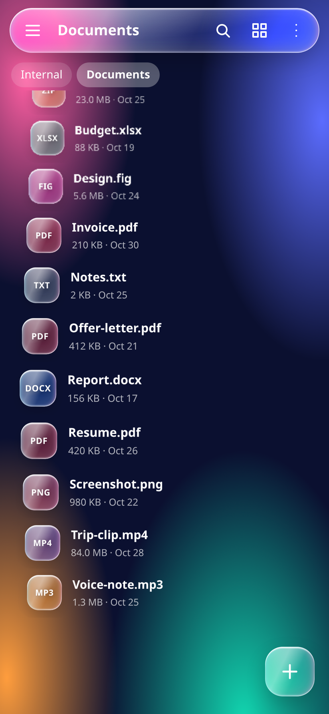

# Lumen Files

A liquid-glass file manager. One HTML file is the whole UI; the Android app is a thin WebView shell around that same file. **No demo data** — the app opens with the six standard empty folders and everything you create is really stored on the device.

<p align="center">
  
</p>

## Download

**[⬇ Download Lumen-Files.apk](https://github.com/technicalnihilist-lgtm/lumen-files/releases/latest/download/Lumen-Files.apk)** — Android 7.0 (API 24) and above, ~122 KB, one permission: **storage**. (Also committed in this repo as [`Lumen-Files.apk`](Lumen-Files.apk), and on the [releases page](https://github.com/technicalnihilist-lgtm/lumen-files/releases).)

1. Copy the APK to your phone and tap it.
2. Allow "install unknown apps" for your browser or file manager when Android asks.
3. Open **Lumen Files**.

Or just open [`index.html`](index.html) in any browser — same app, no install.

## Screenshots

| Home | Folder | Grid | Settings |
|---|---|---|---|
|  |  |  |  |

The **+** menu — new folder, new text file, import files:



Glass settings, with the **Bounce depth**, **4D depth** and **Parallax** sliders:

 

## What it does

- **Browse** — list and grid view, breadcrumb path, folder-first sorting by name, date or size.
- **Search** — searches the whole storage tree, not just the current folder.
- **Select** — long-press a row to start selecting, tap to add or remove, then copy, move or delete. Multi-item delete has a working undo.
- **Create / rename** — new folder, new file, rename with automatic `name (1)` de-duplication. Enter confirms, Escape cancels.
- **Import files** — the **+** menu opens the system file picker (multi-select, any type). Picked files land in the current folder with their real name, size and date, keep their bytes in IndexedDB, and stay there across restarts. Duplicate names get a ` (1)` suffix; deleting an imported file drops its stored bytes too.
- **Copy / paste** — real clipboard bar with *Paste here* and *Cancel*; a folder can't be pasted into itself.
- **Categories** — Images, Videos, Audio, Documents and Downloads views from the drawer.
- **Glass settings** — transparency, liquid effect, sound volume and pitch, transition speed, bounce depth, 20 folder transition styles, animated-glass and tap-sound switches. All of it is remembered.
- **4D bounce** — the new transition style: the list tilts into perspective and every row flies in from depth (`translateZ` + `rotateX` + blur) with a staggered overshoot, then settles flat. Works both opening and closing a folder.
- **Bounce depth** — one slider (0–100%) sets how far the 4D bounce comes from and how hard every tap squashes. At 60% it matches the original feel; at 0% it is flat; at 100% it is exaggerated.
- **4D depth** — the list becomes a curved depth field: each row is projected onto a `translateZ` + `rotateX` + `scale` plane from its distance to the middle of the screen, with a touch of blur at the edges. Re-projected on every scroll frame (rAF), so it stays glued to your finger. 45% by default, 0% turns it off.
- **Parallax** — the gradient layer lags behind the list as you scroll (it moves at a fraction of the list speed) and follows a mouse pointer on desktop. 40% by default, 0% turns it off.
- **Persistence** — the file tree lives in `localStorage`, so folders and files you create survive a restart (and a device reboot).
- **Android back key** — closes the dialog, menu, drawer, selection or search first, steps up one folder next, and leaves the app only when there is nothing left to close.

## Permission

Exactly one: **storage**. Nothing else — no internet, no camera, no contacts, no location, no ads.

| Declared | Covers |
|---|---|
| `READ_EXTERNAL_STORAGE` (`maxSdkVersion=32`) | Android 6 – 12 |
| `WRITE_EXTERNAL_STORAGE` (`maxSdkVersion=29`) | Android 6 – 9 |
| `MANAGE_EXTERNAL_STORAGE` | Android 11+, as the *All files access* toggle |

On Android 6–12 the read permission is asked once at first launch. On Android 11+ you can grant *All files access* yourself under **Settings → Apps → Lumen Files → Special app access**.

## What is not here

The app still manages its own tree — it does not read your phone's real `DCIM`, `Download` or `Pictures` folders yet. The storage permission above is declared and requested, but the native bridge that would map the real filesystem onto this UI is not wired in. When it is, the interface stays exactly as it is now.

## Build the APK yourself

No Gradle, no Android Studio — just `aapt2`, `javac`, `d8`, `zipalign` and `apksigner`.

```bash
# JDK 17 + Android build-tools + a platform, then:
JAVA_HOME=/path/to/jdk SDK=/path/to/android-sdk bash android/build.sh
# -> android/build/Lumen-Files.apk
```

`android/build.sh` copies `index.html` into `assets/`, generates the icons with `android/gen_icon.py`, and signs the result with a throwaway demo key it creates on first run (alias `androiddebugkey`, password `android`). If you rebuild after deleting that key, uninstall the old APK first — a new key means a new signature.

Useful environment variables: `JAVA_HOME`, `SDK`, and `BT` / `ANDROID_JAR` if your SDK is laid out differently from the standard `build-tools/` and `platforms/` folders.

## Project layout

```
index.html                 the entire app (UI + logic, no dependencies)
android/build.sh           the whole build pipeline
android/gen_icon.py        launcher icon generator (adaptive + legacy mipmaps)
android/app/src/main/      manifest, MainActivity (WebView shell), resources
screenshots/               the four screenshots above
```

The web layer exposes `window.lumenBack()` — the shell calls it on the Android back key and only exits when it returns `false`. That is the single hook between Java and JS.

## Fixes in this build

The original file had a few real bugs that are fixed here:

- **New folder / New file / Rename did nothing** — the dialog removed itself from the DOM before its callback read the input, so it threw on a `null` element.
- **Search found nothing** — it only looked in the current folder, so `pdf` at the root matched nothing while `Invoice.pdf` sat in `Download`.
- Selection circles and selected state now render in search results too.
- Changing category kept the previous scroll offset, so the list looked empty.
- The clipboard bar was recreated on every render, replaying its entry animation.
- The back key ignored a pending copy/move instead of cancelling it.
- The storage meter could overflow its track; a corrupt saved transition style could crash the folder animation; a tap in selection mode played the tap sound twice.

## License

MIT — see [LICENSE](LICENSE).

---

## ⭐ Like this work? Give it a star

If you like this app and our work, please **star this repository** ⭐ and **[follow technicalnihilist-lgtm on GitHub](https://github.com/technicalnihilist-lgtm)**. If our work isn't for you, that's completely fine — the choice is yours. Thank you for stopping by!

<details>
<summary><b>🌍 Same message in 32 languages (A–Z + Indian languages)</b></summary>

- **A — Arabic** (العربية): ⭐ إذا أعجبك هذا التطبيق وعملنا، فيرجى منح المستودع نجمة ومتابعتنا. وإذا لم يعجبك عملنا، فلا مشكلة على الإطلاق — القرار قرارك. شكرًا لزيارتك!
- **B — Bengali** (বাংলা): ⭐ যদি আপনার এই অ্যাপ এবং আমাদের কাজ ভালো লাগে, তবে অনুগ্রহ করে রিপোজিটরিটিকে একটি স্টার দিন এবং আমাদের ফলো করুন। আমাদের কাজ যদি আপনার পছন্দ না হয়, তাতেও কোনো সমস্যা নেই — সিদ্ধান্ত আপনার। আমাদের পেজে আসার জন্য ধন্যবাদ!
- **C — Chinese** (中文): ⭐ 如果你喜欢这个应用和我们的作品，请给仓库点个星标并关注我们。如果我们的作品不适合你，也完全没关系——选择权在你。感谢你的到访！
- **D — Dutch** (Nederlands): ⭐ Vind je deze app en ons werk leuk? Geef de repository dan een ster en volg ons. Vind je ons werk niets, dan is dat helemaal prima — de keuze is aan jou. Bedankt voor je bezoek!
- **E — English** (English): ⭐ If you like this app and our work, please give the repository a star and follow us. If our work isn't for you, that's completely fine — the choice is yours. Thank you for stopping by!
- **F — French** (Français): ⭐ Si cette application et notre travail vous plaisent, mettez une étoile au dépôt et suivez-nous. Si notre travail n'est pas pour vous, aucun souci — c'est votre choix. Merci de votre visite !
- **G — German** (Deutsch): ⭐ Wenn dir diese App und unsere Arbeit gefallen, gib dem Repository einen Stern und folge uns. Wenn unsere Arbeit nichts für dich ist, ist das völlig in Ordnung — die Wahl liegt bei dir. Danke fürs Vorbeischauen!
- **H — Hindi** (हिन्दी): ⭐ अगर आपको यह ऐप और हमारा काम पसंद है, तो कृपया रिपॉजिटरी को स्टार दें और हमें फॉलो करें। अगर हमारा काम आपके लिए नहीं है, तो भी कोई बात नहीं — यह पूरी तरह आपकी मर्ज़ी है। यहाँ आने के लिए आपका धन्यवाद!
- **I — Indonesian** (Bahasa Indonesia): ⭐ Jika kamu suka aplikasi ini dan karya kami, beri bintang pada repositori ini dan ikuti kami. Kalau karya kami bukan untukmu, tidak masalah sama sekali — itu pilihanmu. Terima kasih sudah mampir!
- **J — Japanese** (日本語): ⭐ このアプリと私たちの仕事が気に入ったら、リポジトリにスターを付けてフォローしてください。合わない場合はまったく問題ありません — 選ぶのはあなたです。お越しいただきありがとうございます！
- **K — Korean** (한국어): ⭐ 이 앱과 저희 작업이 마음에 드신다면 저장소에 스타를 눌러 주시고 팔로우해 주세요. 저희 작업이 맞지 않으셔도 전혀 괜찮습니다 — 선택은 여러분의 몫입니다. 방문해 주셔서 감사합니다!
- **L — Lithuanian** (Lietuvių): ⭐ Jei tau patinka ši programa ir mūsų darbas, duok saugyklai žvaigždutę ir sek mus. Jei mūsų darbas ne tau, viskas gerai — pasirinkimas tavo. Ačiū, kad užsukai!
- **M — Malayalam** (മലയാളം): ⭐ നിങ്ങൾക്ക് ഈ ആപ്പും ഞങ്ങളുടെ പ്രവർത്തനവും ഇഷ്ടപ്പെട്ടെങ്കിൽ, ദയവായി റെപ്പോസിറ്ററിക്ക് ഒരു സ്റ്റാർ നൽകുകയും ഞങ്ങളെ ഫോളോ ചെയ്യുകയും ചെയ്യുക. ഞങ്ങളുടെ പ്രവർത്തനം നിങ്ങൾക്ക് അനുയോജ്യമല്ലെങ്കിൽ, അതും തികച്ചും കുഴപ്പമില്ല — തീരുമാനം നിങ്ങളുടേതാണ്. ഇവിടെ വന്നതിന് നന്ദി!
- **N — Nepali** (नेपाली): ⭐ यदि तपाईंलाई यो एप र हाम्रो काम मन पर्‍यो भने, कृपया रिपोजिटरीलाई स्टार दिनुहोस् र हामीलाई फलो गर्नुहोस्। यदि हाम्रो काम तपाईंलाई मन पर्दैन भने, पनि ठीकै छ — यो तपाईंको इच्छा हो। यहाँ आउनुभएकोमा धन्यवाद!
- **O — Odia** (ଓଡ଼ିଆ): ⭐ ଯଦି ଆପଣଙ୍କୁ ଏହି ଆପ୍ ଏବଂ ଆମର କାମ ଭଲ ଲାଗୁଛି, ତେବେ ଦୟାକରି ରିପୋଜିଟୋରୀକୁ ଗୋଟିଏ ଷ୍ଟାର୍ ଦିଅନ୍ତୁ ଏବଂ ଆମକୁ ଫଲୋ କରନ୍ତୁ। ଯଦି ଆମର କାମ ଆପଣଙ୍କ ପାଇଁ ନୁହେଁ, ତେବେ କିଛି ଅସୁବିଧା ନାହିଁ — ପସନ୍ଦ ଆପଣଙ୍କର। ଆମ ପାଖକୁ ଆସିଥିବାରୁ ଧନ୍ୟବାଦ!
- **P — Polish** (Polski): ⭐ Jeśli podoba Ci się ta aplikacja i nasza praca, daj repozytorium gwiazdkę i obserwuj nas. Jeśli nasza praca nie jest dla Ciebie, to zupełnie w porządku — wybór należy do Ciebie. Dziękujemy za odwiedziny!
- **Q — Quechua** (Runa Simi): ⭐ Kay app, ñuqaykup ruwasqanchikpas gustasunki chayqa, repositorioman huk estrella churay, ñuqaykutapas qatipayku. Mana gustasunki chayqa, allinmi — qampa akllayki. Hamusqaykimanta sulpayki!
- **R — Russian** (Русский): ⭐ Если вам нравится это приложение и наша работа, поставьте звёздочку репозиторию и подпишитесь на нас. Если наша работа не для вас — это совершенно нормально, выбор за вами. Спасибо, что заглянули!
- **S — Spanish** (Español): ⭐ Si te gusta esta app y nuestro trabajo, dale una estrella al repositorio y síguenos. Si nuestro trabajo no es para ti, no pasa nada — la decisión es tuya. ¡Gracias por pasarte!
- **T — Tamil** (தமிழ்): ⭐ உங்களுக்கு இந்த ஆப்பும் எங்க வேலையும் பிடிச்சிருந்தா, தயவுசெஞ்சு இந்த ரெபாசிட்டரிக்கு ஒரு ஸ்டார் குடுத்து, எங்களை ஃபாலோ பண்ணுங்க. எங்க வேலை உங்களுக்கு செட் ஆகலைன்னாலும் பரவாயில்லை — அது உங்க விருப்பம். இங்கே வந்ததுக்கு நன்றி!
- **U — Urdu** (اردو): ⭐ اگر آپ کو یہ ایپ اور ہمارا کام پسند آئے تو براہ کرم ریپازٹری کو سٹار دیں اور ہمیں فالو کریں۔ اگر ہمارا کام آپ کے لیے نہیں ہے، تو یہ بالکل ٹھیک ہے — انتخاب آپ کا ہے۔ یہاں تشریف لانے کا شکریہ!
- **V — Vietnamese** (Tiếng Việt): ⭐ Nếu bạn thích ứng dụng này và công việc của chúng tôi, hãy tặng kho lưu trữ một ngôi sao và theo dõi chúng tôi. Nếu công việc của chúng tôi không phù hợp với bạn, điều đó hoàn toàn ổn — lựa chọn là của bạn. Cảm ơn bạn đã ghé qua!
- **W — Welsh** (Cymraeg): ⭐ Os ydych chi'n hoffi'r ap hwn a'n gwaith, rhowch seren i'r storfa a dilynwch ni. Os nad yw ein gwaith ar eich cyfer, mae hynny'n hollol iawn — chi sydd i benderfynu. Diolch am alw heibio!
- **X — Xhosa** (isiXhosa): ⭐ Ukuba uyayithanda le app nomsebenzi wethu, nika irepo inkwenkwezi kwaye usilandele. Ukuba umsebenzi wethu awukufanelanga, akukho ngxaki — lukhetho lwakho. Enkosi ngokutyelela!
- **Y — Yoruba** (Yorùbá): ⭐ Bí app yìí àti iṣẹ́ wa bá wù ọ́, jọ̀wọ́ fún àkójọpọ̀ náà ní ìràwọ̀ kí o sì tẹ̀lé wa. Bí iṣẹ́ wa kò bá yẹ ọ́, kò séwu — ìwọ ni ó yàn. Ẹ ṣé fún wíwá!
- **Z — Zulu** (isiZulu): ⭐ Uma uthanda le app nomsebenzi wethu, nikeza isitoreji inkanyezi bese usilandela. Uma umsebenzi wethu ungakufanele, akunankinga — wukukhetha kwakho. Siyabonga ngokuvakasha!

**More Indian languages**

- **Assamese** (অসমীয়া): ⭐ যদি আপুনি এই এপটো আৰু আমাৰ কাম ভাল পায়, তেন্তে অনুগ্ৰহ কৰি ৰিপজিটৰীটোক এটা ষ্টাৰ দিয়ক আৰু আমাক ফ'ল' কৰক। যদি আমাৰ কাম আপোনাৰ বাবে নহয়, তেন্তে সেয়া একেবাৰে ঠিক আছে — সিদ্ধান্তটো আপোনাৰ। আমাৰ ইয়ালৈ অহাৰ বাবে ধন্যবাদ!
- **Gujarati** (ગુજરાતી): ⭐ જો તમને આ એપ અને અમારું કામ ગમતું હોય, તો પ્લીઝ રિપોઝિટરીને સ્ટાર આપો અને અમને ફોલો કરો. જો અમારું કામ તમને ન ગમતું હોય, તો તે પણ બરાબર છે — પસંદગી તમારી છે. અહીં આવવા બદલ આભાર!
- **Kannada** (ಕನ್ನಡ): ⭐ ನಿಮಗೆ ಈ ಆ್ಯಪ್ ಮತ್ತು ನಮ್ಮ ಕೆಲಸ ಇಷ್ಟವಾದರೆ, ದಯವಿಟ್ಟು ರೆಪೊಸಿಟರಿಗೆ ಸ್ಟಾರ್ ಕೊಡಿ ಮತ್ತು ನಮ್ಮನ್ನು ಫಾಲೋ ಮಾಡಿ. ನಮ್ಮ ಕೆಲಸ ನಿಮಗೆ ಸರಿಹೊಂದದಿದ್ದರೆ, ಅದೂ ಪರವಾಗಿಲ್ಲ — ಆಯ್ಕೆ ನಿಮ್ಮದು. ಭೇಟಿ ನೀಡಿದ್ದಕ್ಕೆ ಧನ್ಯವಾದಗಳು!
- **Marathi** (मराठी): ⭐ जर तुम्हाला हे ॲप आणि आमचं काम आवडलं असेल, तर कृपया रिपॉझिटरीला स्टार द्या आणि आम्हाला फॉलो करा. जर आमचं काम तुम्हाला आवडत नसेल, तर काही हरकत नाही — ती तुमची निवड आहे. इथे आल्याबद्दल धन्यवाद!
- **Punjabi** (ਪੰਜਾਬੀ): ⭐ ਜੇ ਤੁਹਾਨੂੰ ਇਹ ਐਪ ਅਤੇ ਸਾਡਾ ਕੰਮ ਪਸੰਦ ਹੈ, ਤਾਂ ਕਿਰਪਾ ਕਰਕੇ ਰਿਪੋਜ਼ਟਰੀ ਨੂੰ ਸਟਾਰ ਦਿਓ ਅਤੇ ਸਾਨੂੰ ਫਾਲੋ ਕਰੋ। ਜੇ ਸਾਡਾ ਕੰਮ ਤੁਹਾਡੇ ਲਈ ਨਹੀਂ ਹੈ, ਤਾਂ ਕੋਈ ਗੱਲ ਨਹੀਂ — ਚੋਣ ਤੁਹਾਡੀ ਹੈ। ਸਾਡੇ ਪੇਜ 'ਤੇ ਆਉਣ ਲਈ ਧੰਨਵਾਦ!
- **Telugu** (తెలుగు): ⭐ మీకు ఈ యాప్, మా పని నచ్చితే, దయచేసి రిపోజిటరీకి ఒక స్టార్ ఇచ్చి మమ్మల్ని ఫాలో అవ్వండి. ఒకవేళ మా పని మీకు నచ్చకపోతే, పర్వాలేదు — అది మీ ఇష్టం. మమ్మల్ని సందర్శించినందుకు ధన్యవాదాలు!

</details>
