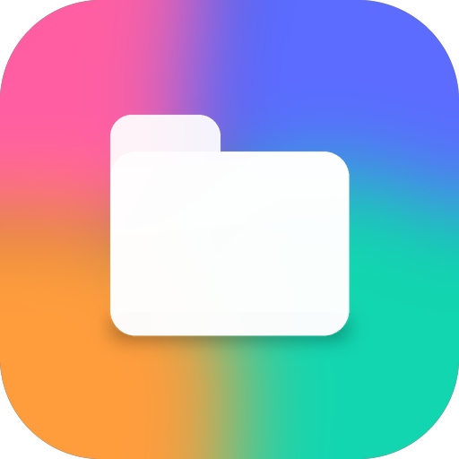
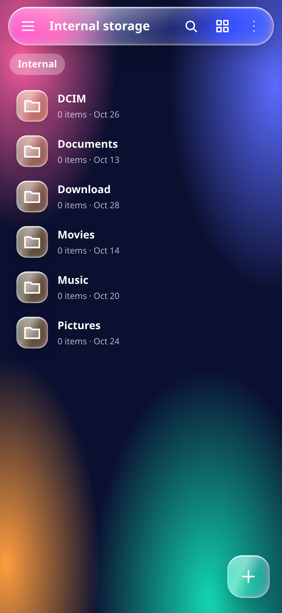
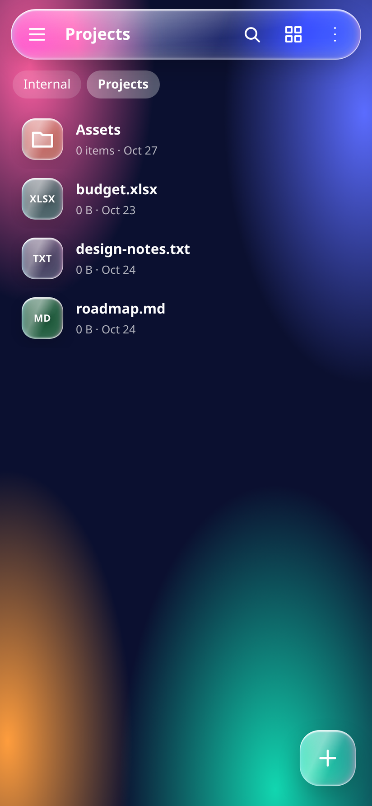
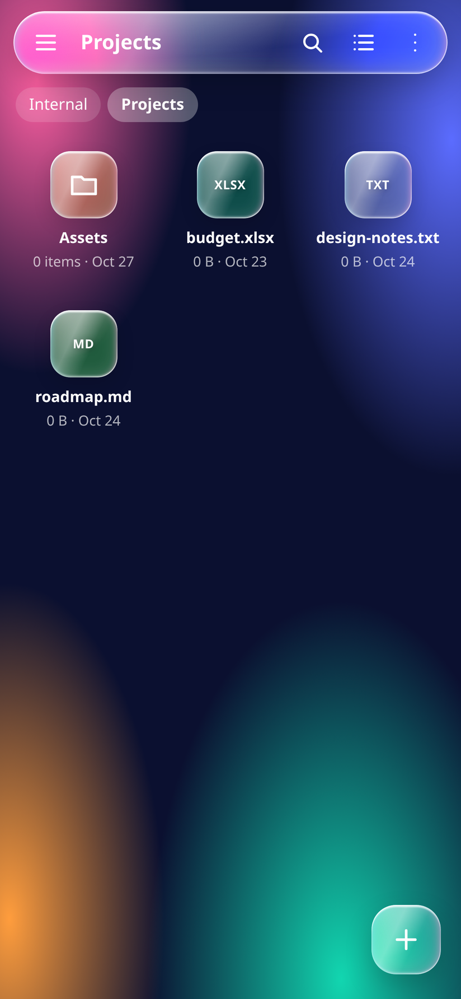
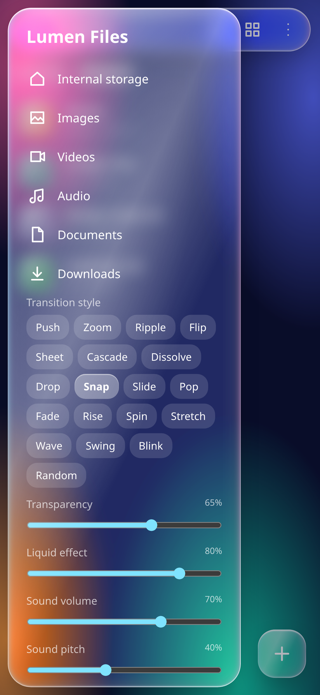

# Lumen Files

A liquid-glass file manager. One HTML file is the whole UI; the Android app is a thin WebView shell around that same file. **No demo data** — the app opens with the six standard empty folders and everything you create is really stored on the device.

<p align="center">
  
</p>

## Download

**[⬇ Lumen-Files.apk](Lumen-Files.apk)** — Android 7.0 (API 24) and above, ~122 KB, no permissions.

1. Copy the APK to your phone and tap it.
2. Allow "install unknown apps" for your browser or file manager when Android asks.
3. Open **Lumen Files**.

Or just open [`index.html`](index.html) in any browser — same app, no install.

## Screenshots

| Home | Folder | Grid | Settings |
|---|---|---|---|
|  |  |  |  |

## What it does

- **Browse** — list and grid view, breadcrumb path, folder-first sorting by name, date or size.
- **Search** — searches the whole storage tree, not just the current folder.
- **Select** — long-press a row to start selecting, tap to add or remove, then copy, move or delete. Multi-item delete has a working undo.
- **Create / rename** — new folder, new file, rename with automatic `name (1)` de-duplication. Enter confirms, Escape cancels.
- **Copy / paste** — real clipboard bar with *Paste here* and *Cancel*; a folder can't be pasted into itself.
- **Categories** — Images, Videos, Audio, Documents and Downloads views from the drawer.
- **Glass settings** — transparency, liquid effect, sound volume and pitch, transition speed, 19 folder transition styles, animated-glass and tap-sound switches. All of it is remembered.
- **Persistence** — the file tree lives in `localStorage`, so folders and files you create survive a restart (and a device reboot).
- **Android back key** — closes the dialog, menu, drawer, selection or search first, steps up one folder next, and leaves the app only when there is nothing left to close.

## What is not here

The app manages its own tree — it does not read your phone's real `DCIM`, `Download` or `Pictures` folders. Reading the actual filesystem needs a native storage bridge (`MANAGE_EXTERNAL_STORAGE` or SAF), which is deliberately not wired in: the APK requests **zero permissions**.

## Build the APK yourself

No Gradle, no Android Studio — just `aapt2`, `javac`, `d8`, `zipalign` and `apksigner`.

```bash
# JDK 17 + Android build-tools + a platform, then:
JAVA_HOME=/path/to/jdk SDK=/path/to/android-sdk bash android/build.sh
# -> android/build/Lumen-Files.apk
```

`android/build.sh` copies `index.html` into `assets/`, generates the icons with `android/gen_icon.py`, and signs the result with a throwaway demo key it creates on first run (alias `androiddebugkey`, password `android`). If you rebuild after deleting that key, uninstall the old APK first — a new key means a new signature.

Useful environment variables: `JAVA_HOME`, `SDK`, and `BT` / `ANDROID_JAR` if your SDK is laid out differently from the standard `build-tools/` and `platforms/` folders.

## Project layout

```
index.html                 the entire app (UI + logic, no dependencies)
android/build.sh           the whole build pipeline
android/gen_icon.py        launcher icon generator (adaptive + legacy mipmaps)
android/app/src/main/      manifest, MainActivity (WebView shell), resources
screenshots/               the four screenshots above
```

The web layer exposes `window.lumenBack()` — the shell calls it on the Android back key and only exits when it returns `false`. That is the single hook between Java and JS.

## Fixes in this build

The original file had a few real bugs that are fixed here:

- **New folder / New file / Rename did nothing** — the dialog removed itself from the DOM before its callback read the input, so it threw on a `null` element.
- **Search found nothing** — it only looked in the current folder, so `pdf` at the root matched nothing while `Invoice.pdf` sat in `Download`.
- Selection circles and selected state now render in search results too.
- Changing category kept the previous scroll offset, so the list looked empty.
- The clipboard bar was recreated on every render, replaying its entry animation.
- The back key ignored a pending copy/move instead of cancelling it.
- The storage meter could overflow its track; a corrupt saved transition style could crash the folder animation; a tap in selection mode played the tap sound twice.

## License

MIT — see [LICENSE](LICENSE).
