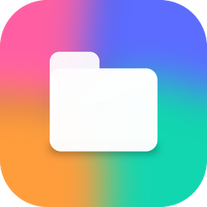
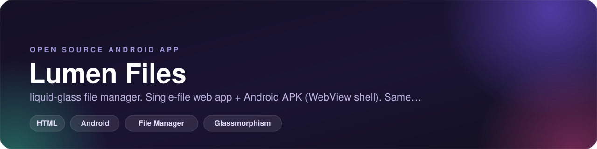
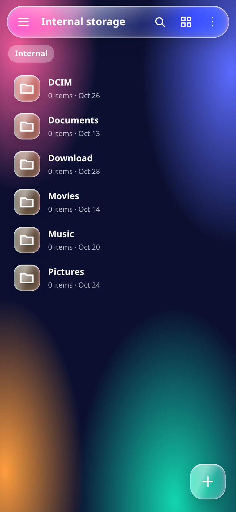
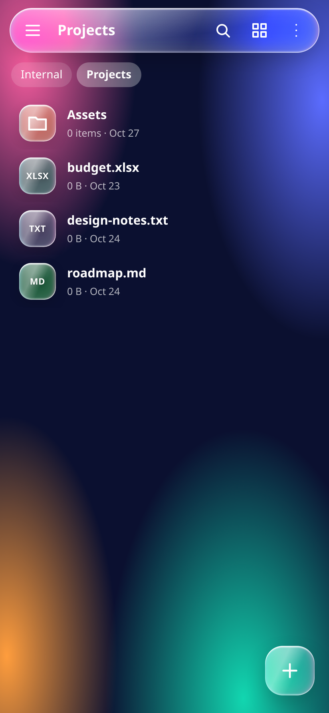
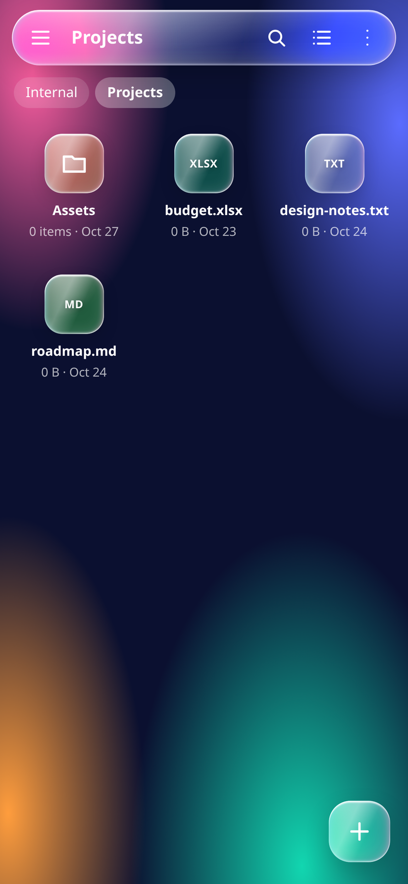
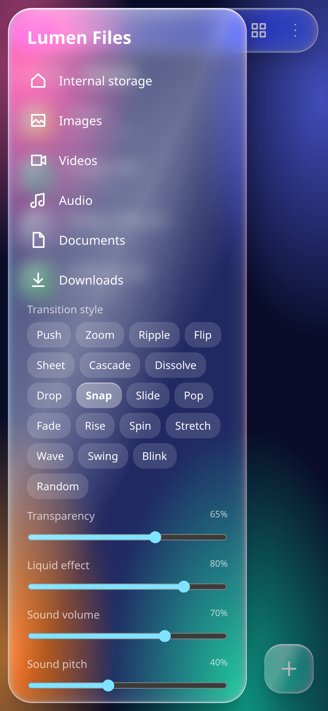
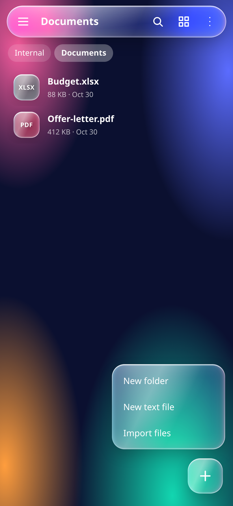
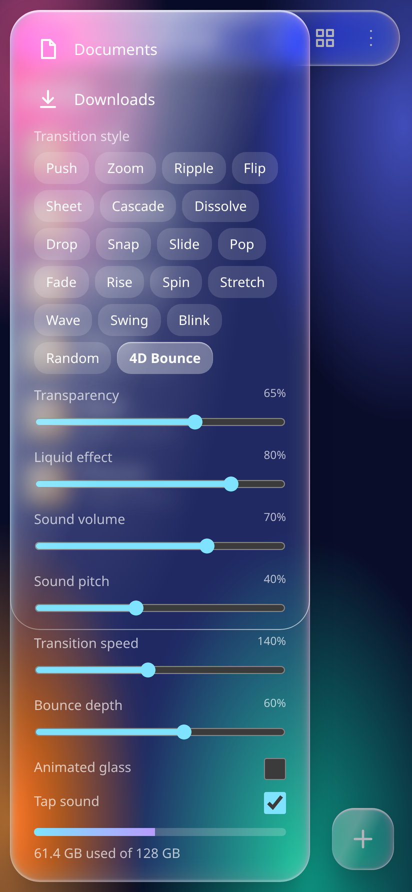
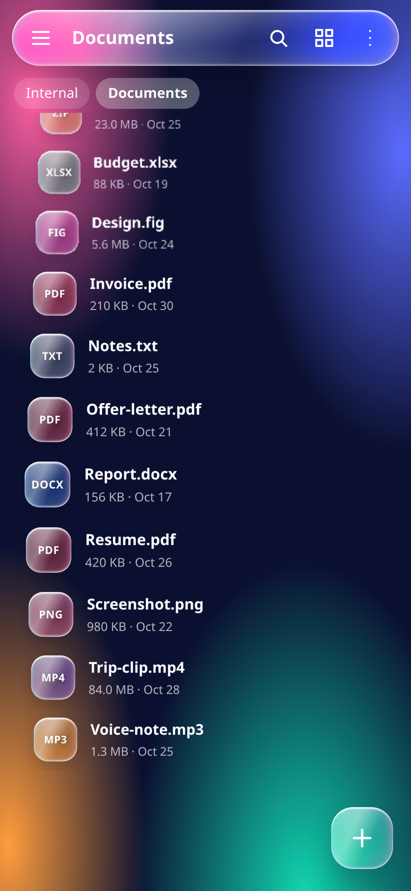

<div align="center">





<a href="https://github.com/technicalnihilist-lgtm/lumen-files/stargazers"></a>&nbsp;<a href="https://github.com/technicalnihilist-lgtm/lumen-files/network/members"></a>

<a href="https://github.com/technicalnihilist-lgtm/lumen-files/releases/latest/download/Lumen-Files.apk"></a> <a href="https://technicalnihilist-lgtm.github.io/apps-site/apps/lumen-files.html"></a>

<b>Support the work</b>

  

<sub>Donations aren't live yet — Paytm, UPI, PayPal and Buy&nbsp;Me&nbsp;a&nbsp;Coffee all show <b>coming soon</b>. Until then, a ⭐ star is the best support.</sub>

<a href="https://github.com/technicalnihilist-lgtm/lumen-files/releases/latest"></a>  <a href="https://github.com/technicalnihilist-lgtm/lumen-files/releases"></a>

</div>

---

## Download

**[⬇ Download Lumen-Files.apk](https://github.com/technicalnihilist-lgtm/lumen-files/releases/latest/download/Lumen-Files.apk)** — Android 7.0 (API 24) and above, ~122 KB, one permission: **storage**. (Also committed in this repo as [`Lumen-Files.apk`](Lumen-Files.apk), and on the [releases page](https://github.com/technicalnihilist-lgtm/lumen-files/releases).)

1. Copy the APK to your phone and tap it.
2. Allow "install unknown apps" for your browser or file manager when Android asks.
3. Open **Lumen Files**.

Or just open [`index.html`](index.html) in any browser — same app, no install.

## Screenshots

| Home | Folder | Grid | Settings |
|---|---|---|---|
|  |  |  |  |

The **+** menu — new folder, new text file, import files:



Glass settings, with the **Bounce depth**, **4D depth** and **Parallax** sliders:

 

## What it does

- **Browse** — list and grid view, breadcrumb path, folder-first sorting by name, date or size.
- **Search** — searches the whole storage tree, not just the current folder.
- **Select** — long-press a row to start selecting, tap to add or remove, then copy, move or delete. Multi-item delete has a working undo.
- **Create / rename** — new folder, new file, rename with automatic `name (1)` de-duplication. Enter confirms, Escape cancels.
- **Import files** — the **+** menu opens the system file picker (multi-select, any type). Picked files land in the current folder with their real name, size and date, keep their bytes in IndexedDB, and stay there across restarts. Duplicate names get a ` (1)` suffix; deleting an imported file drops its stored bytes too.
- **Copy / paste** — real clipboard bar with *Paste here* and *Cancel*; a folder can't be pasted into itself.
- **Categories** — Images, Videos, Audio, Documents and Downloads views from the drawer.
- **Glass settings** — transparency, liquid effect, sound volume and pitch, transition speed, bounce depth, 20 folder transition styles, animated-glass and tap-sound switches. All of it is remembered.
- **4D bounce** — the new transition style: the list tilts into perspective and every row flies in from depth (`translateZ` + `rotateX` + blur) with a staggered overshoot, then settles flat. Works both opening and closing a folder.
- **Bounce depth** — one slider (0–100%) sets how far the 4D bounce comes from and how hard every tap squashes. At 60% it matches the original feel; at 0% it is flat; at 100% it is exaggerated.
- **4D depth** — the list becomes a curved depth field: each row is projected onto a `translateZ` + `rotateX` + `scale` plane from its distance to the middle of the screen, with a touch of blur at the edges. Re-projected on every scroll frame (rAF), so it stays glued to your finger. 45% by default, 0% turns it off.
- **Parallax** — the gradient layer lags behind the list as you scroll (it moves at a fraction of the list speed) and follows a mouse pointer on desktop. 40% by default, 0% turns it off.
- **Persistence** — the file tree lives in `localStorage`, so folders and files you create survive a restart (and a device reboot).
- **Android back key** — closes the dialog, menu, drawer, selection or search first, steps up one folder next, and leaves the app only when there is nothing left to close.

## Permission

Exactly one: **storage**. Nothing else — no internet, no camera, no contacts, no location, no ads.

| Declared | Covers |
|---|---|
| `READ_EXTERNAL_STORAGE` (`maxSdkVersion=32`) | Android 6 – 12 |
| `WRITE_EXTERNAL_STORAGE` (`maxSdkVersion=29`) | Android 6 – 9 |
| `MANAGE_EXTERNAL_STORAGE` | Android 11+, as the *All files access* toggle |

On Android 6–12 the read permission is asked once at first launch. On Android 11+ you can grant *All files access* yourself under **Settings → Apps → Lumen Files → Special app access**.

## What is not here

The app still manages its own tree — it does not read your phone's real `DCIM`, `Download` or `Pictures` folders yet. The storage permission above is declared and requested, but the native bridge that would map the real filesystem onto this UI is not wired in. When it is, the interface stays exactly as it is now.

## Build the APK yourself

No Gradle, no Android Studio — just `aapt2`, `javac`, `d8`, `zipalign` and `apksigner`.

```bash
## Project layout

```
index.html                 the entire app (UI + logic, no dependencies)
android/build.sh           the whole build pipeline
android/gen_icon.py        launcher icon generator (adaptive + legacy mipmaps)
android/app/src/main/      manifest, MainActivity (WebView shell), resources
screenshots/               the four screenshots above
```

The web layer exposes `window.lumenBack()` — the shell calls it on the Android back key and only exits when it returns `false`. That is the single hook between Java and JS.

## Fixes in this build

The original file had a few real bugs that are fixed here:

- **New folder / New file / Rename did nothing** — the dialog removed itself from the DOM before its callback read the input, so it threw on a `null` element.
- **Search found nothing** — it only looked in the current folder, so `pdf` at the root matched nothing while `Invoice.pdf` sat in `Download`.
- Selection circles and selected state now render in search results too.
- Changing category kept the previous scroll offset, so the list looked empty.
- The clipboard bar was recreated on every render, replaying its entry animation.
- The back key ignored a pending copy/move instead of cancelling it.
- The storage meter could overflow its track; a corrupt saved transition style could crash the folder animation; a tap in selection mode played the tap sound twice.

## License

MIT — see [LICENSE](LICENSE).

---

---

## 🌍 Languages

<sub>Donations are <b>coming soon</b> in every language below — nothing to pay today, nothing to click.</sub>

<div align="center">

<sub><b>हिन्दी · বাংলা · मराठी · తెలుగు · தமிழ் · ગુજરાતી · ಕನ್ನಡ · മലയാളം · ਪੰਜਾਬੀ · ଓଡ଼ିଆ · অসমীয়া · اردو</b></sub>

</div>

<details>
<summary><b>🌍 Open the same message in 53 languages</b></summary>

**🇮🇳 Indian languages**

- **हिन्दी** (Hindi) — ☕ जल्द ही आ रहा है। · ⭐ अगर आपको यह ऐप और हमारा काम पसंद है, तो कृपया रिपॉजिटरी को स्टार दें और हमें फॉलो करें।
- **বাংলা** (Bengali) — ☕ খুব শিগগিরই আসছে। · ⭐ যদি আপনার এই অ্যাপ এবং আমাদের কাজ ভালো লাগে, তবে অনুগ্রহ করে রিপোজিটরিটিকে একটি স্টার দিন এবং আমাদের ফলো করুন।
- **मराठी** (Marathi) — ☕ लवकरच येत आहे. · ⭐ जर तुम्हाला हे ॲप आणि आमचं काम आवडलं असेल, तर कृपया रिपॉझिटरीला स्टार द्या आणि आम्हाला फॉलो करा.
- **తెలుగు** (Telugu) — ☕ త్వరలో రాబోతోంది. · ⭐ మీకు ఈ యాప్, మా పని నచ్చితే, దయచేసి రిపోజిటరీకి ఒక స్టార్ ఇచ్చి మమ్మల్ని ఫాలో అవ్వండి.
- **தமிழ்** (Tamil) — ☕ விரைவில் வருகிறது. · ⭐ உங்களுக்கு இந்த ஆப்பும் எங்க வேலையும் பிடிச்சிருந்தா, தயவுசெஞ்சு இந்த ரெபாசிட்டரிக்கு ஒரு ஸ்டார்…
- **ગુજરાતી** (Gujarati) — ☕ ટૂંક સમયમાં આવી રહ્યું છે. · ⭐ જો તમને આ એપ અને અમારું કામ ગમતું હોય, તો પ્લીઝ રિપોઝિટરીને સ્ટાર આપો અને અમને ફોલો કરો.
- **ಕನ್ನಡ** (Kannada) — ☕ ಶೀಘ್ರದಲ್ಲೇ ಬರುತ್ತಿದೆ. · ⭐ ನಿಮಗೆ ಈ ಆ್ಯಪ್ ಮತ್ತು ನಮ್ಮ ಕೆಲಸ ಇಷ್ಟವಾದರೆ, ದಯವಿಟ್ಟು ರೆಪೊಸಿಟರಿಗೆ ಸ್ಟಾರ್ ಕೊಡಿ ಮತ್ತು ನಮ್ಮನ್ನು ಫಾಲೋ ಮಾಡಿ.
- **മലയാളം** (Malayalam) — ☕ ഉടൻ വരുന്നു. · ⭐ നിങ്ങൾക്ക് ഈ ആപ്പും ഞങ്ങളുടെ പ്രവർത്തനവും ഇഷ്ടപ്പെട്ടെങ്കിൽ, ദയവായി റെപ്പോസിറ്ററിക്ക് ഒരു സ്റ്റാർ…
- **ਪੰਜਾਬੀ** (Punjabi) — ☕ ਜਲਦੀ ਆ ਰਿਹਾ ਹੈ। · ⭐ ਜੇ ਤੁਹਾਨੂੰ ਇਹ ਐਪ ਅਤੇ ਸਾਡਾ ਕੰਮ ਪਸੰਦ ਹੈ, ਤਾਂ ਕਿਰਪਾ ਕਰਕੇ ਰਿਪੋਜ਼ਟਰੀ ਨੂੰ ਸਟਾਰ ਦਿਓ ਅਤੇ ਸਾਨੂੰ ਫਾਲੋ ਕਰੋ।
- **ଓଡ଼ିଆ** (Odia) — ☕ ଖୁବ୍ ଶୀଘ୍ର ଆସୁଛି। · ⭐ ଯଦି ଆପଣଙ୍କୁ ଏହି ଆପ୍ ଏବଂ ଆମର କାମ ଭଲ ଲାଗୁଛି, ତେବେ ଦୟାକରି ରିପୋଜିଟୋରୀକୁ ଗୋଟିଏ ଷ୍ଟାର୍ ଦିଅନ୍ତୁ ଏବଂ ଆମକୁ ଫଲୋ କରନ୍ତୁ।
- **অসমীয়া** (Assamese) — ☕ অতি সোনকালেই আহি আছে। · ⭐ যদি আপুনি এই এপটো আৰু আমাৰ কাম ভাল পায়, তেন্তে অনুগ্ৰহ কৰি ৰিপজিটৰীটোক এটা ষ্টাৰ দিয়ক আৰু আমাক ফ'ল' কৰক।
- **اردو** (Urdu) — ☕ جلد آرہا ہے۔ · ⭐ اگر آپ کو یہ ایپ اور ہمارا کام پسند آئے تو براہ کرم ریپازٹری کو سٹار دیں اور ہمیں فالو کریں۔
- **संस्कृतम्** (Sanskrit) — ☕ शीघ्रमेव आगच्छति।
- **मैथिली** (Maithili) — ☕ जल्दिये आबि रहल अछि।
- **कोंकणी** (Konkani) — ☕ रोखडेंच येता.
- **کٲشُر** (Kashmiri) — ☕ جَلدی یِوان چھُ۔
- **سنڌي** (Sindhi) — ☕ जल्द अची रह्यो आहे।
- **डोगरी** (Dogri) — ☕ जल्दी आ करदा ऐ।
- **ꯃꯤꯇꯩ ꯂꯣꯟ** (Manipuri) — ☕ ꯑꯊꯨꯕꯥ ꯃꯇꯝꯗꯥ ꯂꯥꯛꯀꯅꯤ꯫
- **बर’** (Bodo) — ☕ थाबैनो फैगोन।
- **ᱥᱟᱱᱛᱟᱲᱤ** (Santali) — ☕ ᱞᱚᱜᱚᱱ ᱦᱤᱡᱩᱜ ᱠᱟᱱᱟ᱾
- **नेपाली** (Nepali) — ☕ छिट्टै आउँदैछ। · ⭐ यदि तपाईंलाई यो एप र हाम्रो काम मन पर्‍यो भने, कृपया रिपोजिटरीलाई स्टार दिनुहोस् र हामीलाई फलो गर्नुहोस्।

**🌍 World languages**

- **العربية** (Arabic) — ☕ قريبًا. · ⭐ إذا أعجبك هذا التطبيق وعملنا، فيرجى منح المستودع نجمة ومتابعتنا.
- **简体中文** (Chinese (Simplified)) — ☕ 即将推出。
- **繁體中文** (Chinese (Traditional)) — ☕ 即將推出。
- **Čeština** (Czech) — ☕ Již brzy.
- **Dansk** (Danish) — ☕ Kommer snart.
- **Nederlands** (Dutch) — ☕ Binnenkort beschikbaar. · ⭐ Vind je deze app en ons werk leuk?
- **Filipino** (Filipino) — ☕ Malapit na.
- **Suomi** (Finnish) — ☕ Tulossa pian.
- **Français** (French) — ☕ Bientôt disponible. · ⭐ Si cette application et notre travail vous plaisent, mettez une étoile au dépôt et suivez-nous.
- **Deutsch** (German) — ☕ Bald verfügbar. · ⭐ Wenn dir diese App und unsere Arbeit gefallen, gib dem Repository einen Stern und folge uns.
- **Ελληνικά** (Greek) — ☕ Έρχεται σύντομα.
- **עברית** (Hebrew) — ☕ בקרוב.
- **Magyar** (Hungarian) — ☕ Hamarosan.
- **Bahasa Indonesia** (Indonesian) — ☕ Segera hadir. · ⭐ Jika kamu suka aplikasi ini dan karya kami, beri bintang pada repositori ini dan ikuti kami.
- **Italiano** (Italian) — ☕ In arrivo.
- **日本語** (Japanese) — ☕ 近日公開。 · ⭐ このアプリと私たちの仕事が気に入ったら、リポジトリにスターを付けてフォローしてください。
- **한국어** (Korean) — ☕ 곧 공개됩니다. · ⭐ 이 앱과 저희 작업이 마음에 드신다면 저장소에 스타를 눌러 주시고 팔로우해 주세요.
- **Bahasa Melayu** (Malay) — ☕ Akan datang.
- **Norsk** (Norwegian) — ☕ Kommer snart.
- **فارسی** (Persian) — ☕ به‌زودی.
- **Polski** (Polish) — ☕ Wkrótce. · ⭐ Jeśli podoba Ci się ta aplikacja i nasza praca, daj repozytorium gwiazdkę i obserwuj nas.
- **Português** (Portuguese) — ☕ Em breve.
- **Română** (Romanian) — ☕ În curând.
- **Русский** (Russian) — ☕ Скоро. · ⭐ Если вам нравится это приложение и наша работа, поставьте звёздочку репозиторию и подпишитесь на нас.
- **Español** (Spanish) — ☕ Muy pronto. · ⭐ Si te gusta esta app y nuestro trabajo, dale una estrella al repositorio y síguenos.
- **Kiswahili** (Swahili) — ☕ Inakuja hivi karibuni.
- **Svenska** (Swedish) — ☕ Kommer snart.
- **ไทย** (Thai) — ☕ เร็ว ๆ นี้
- **Türkçe** (Turkish) — ☕ Çok yakında.
- **Українська** (Ukrainian) — ☕ Незабаром.
- **Tiếng Việt** (Vietnamese) — ☕ Sắp ra mắt. · ⭐ Nếu bạn thích ứng dụng này và công việc của chúng tôi, hãy tặng kho lưu trữ một ngôi sao và theo…

</details>

